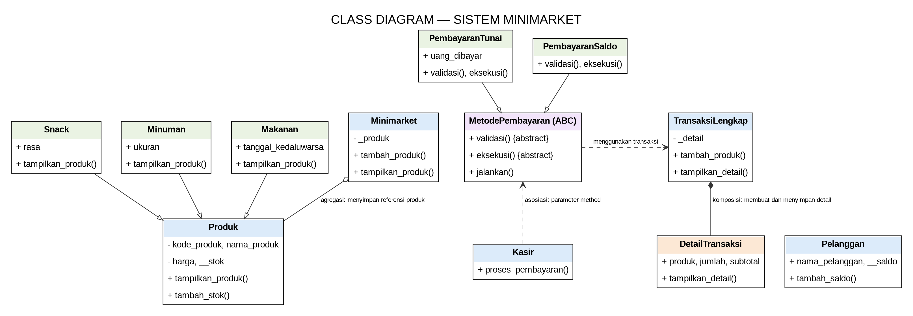
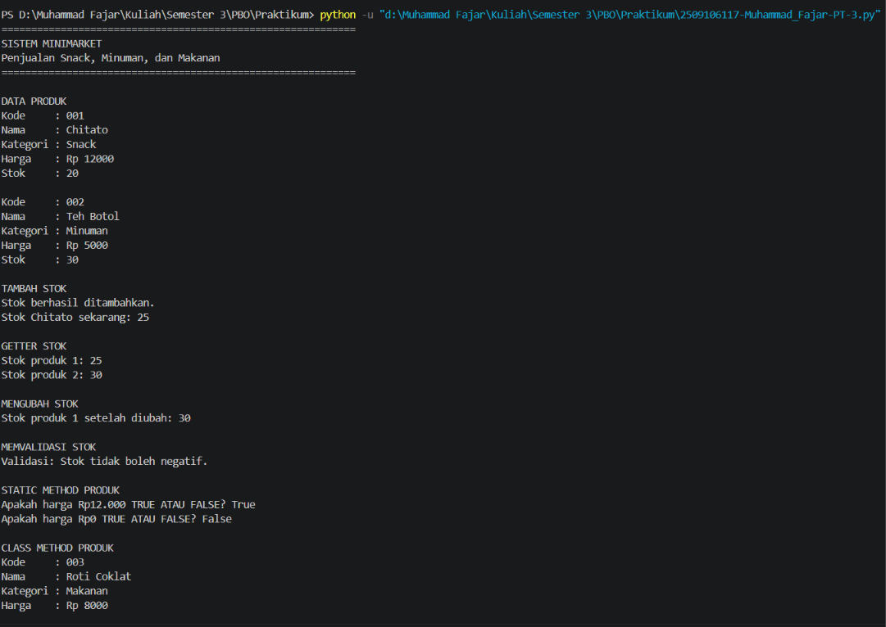
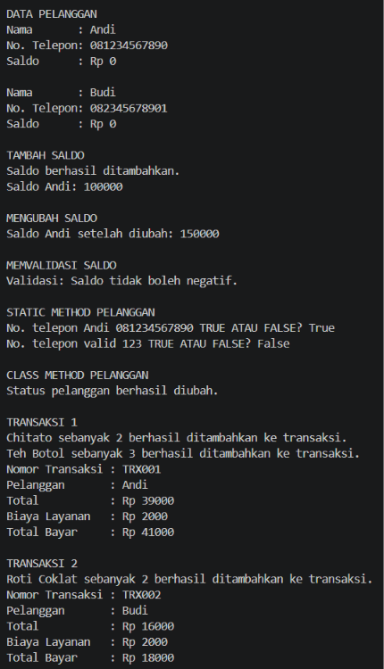
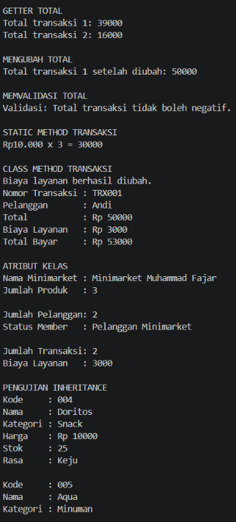
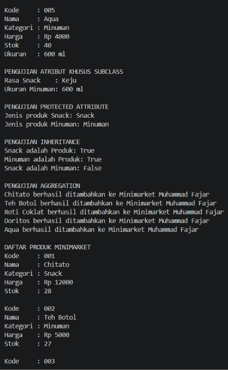
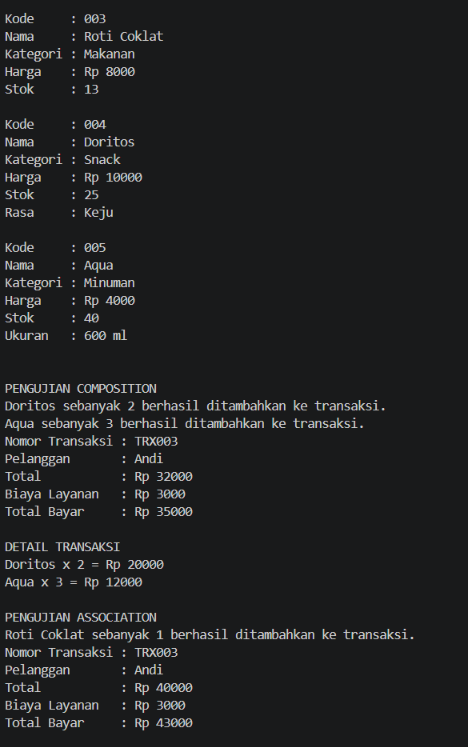
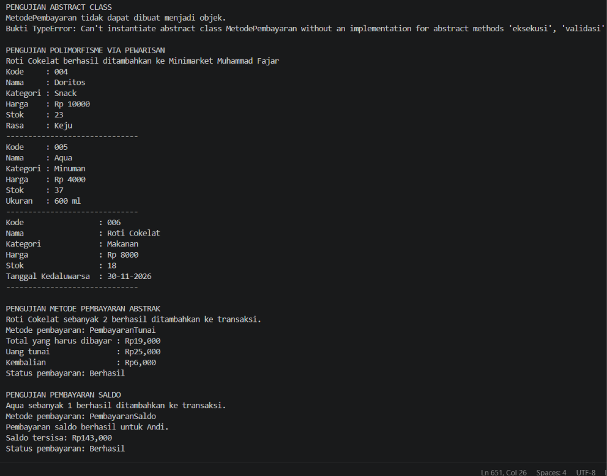
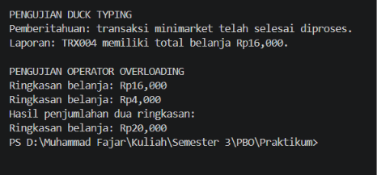
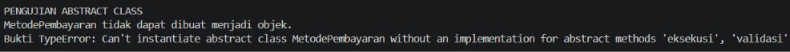
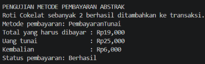

# Sistem Minimarket untuk Penjualan Snack, Minuman, dan Makanan

```text
NIM = 2509106117
NAMA = MUHAMMAD FAJAR
KELAS = C2'25
```

## Deskripsi Program

Program ini merupakan lanjutan dari program Posttest 2. Program digunakan untuk menggambarkan proses sederhana minimarket, mulai dari pengelolaan produk, pelanggan, transaksi, detail transaksi, hingga pembayaran. Jenis produk yang tersedia meliputi snack, minuman, dan makanan.

File Python Posttest 3 mempertahankan kode Posttest 2 di bagian awal, kemudian menambahkan penerapan abstraksi, polimorfisme, operator overloading, serta satu prinsip SOLID. Program menggunakan Python dan tidak membutuhkan pustaka tambahan di luar pustaka standar.

## Class Diagram



### Penjelasan Relasi Kelas

- **Asosiasi — `Kasir` ke `MetodePembayaran`:** `Kasir.proses_pembayaran()` menerima objek metode pembayaran sebagai parameter dan langsung menggunakannya. Objek pembayaran tidak disimpan sebagai atribut tetap di dalam `Kasir`, sehingga keduanya dapat dibuat dan digunakan secara terpisah.
- **Agregasi — `Minimarket` ke `Produk`:** `Minimarket` menyimpan referensi objek produk di dalam atribut `_produk`. Objek produk dibuat di luar minimarket dan tetap dapat digunakan meskipun objek `Minimarket` tidak lagi digunakan; karena itu hubungan ini merupakan agregasi, bukan komposisi.
- **Komposisi — `TransaksiLengkap` ke `DetailTransaksi`:** `TransaksiLengkap.tambah_produk()` membuat objek `DetailTransaksi` dan menyimpannya di dalam `_detail`. Detail tersebut dibuat sebagai bagian dari pencatatan transaksi dan dikelola melalui transaksi yang memilikinya, sehingga hubungan ini dimodelkan sebagai komposisi.

Garis pewarisan pada diagram menunjukkan bahwa `Snack`, `Minuman`, dan `Makanan` merupakan turunan `Produk`. `PembayaranTunai` dan `PembayaranSaldo` merupakan turunan dari kelas abstrak `MetodePembayaran`.

## Penerapan Abstraksi

Kelas **`MetodePembayaran`** mewarisi `ABC` dan memiliki dua method abstrak, yaitu `validasi()` dan `eksekusi()`. Kelas `PembayaranTunai` dan `PembayaranSaldo` mengimplementasikan kedua method tersebut dengan cara yang berbeda. Kelas abstrak juga memiliki method konkret `jalankan()` yang digunakan bersama oleh kedua subclass.

Program mencoba membuat objek `MetodePembayaran` secara langsung menggunakan `try-except`. Python menolak pembuatan objek tersebut dan menghasilkan `TypeError` karena method abstraknya belum diimplementasikan oleh kelas konkret.

## Penerapan Polimorfisme

### 1. Polimorfisme melalui Pewarisan

Method `tampilkan_produk()` di kelas `Produk` di-override oleh `Snack`, `Minuman`, dan `Makanan`. Ketiga objek dipanggil melalui satu perulangan (`for item in daftar_produk_posttest3`), tetapi setiap objek menampilkan atribut khususnya sendiri.

Selain itu, `PembayaranTunai` dan `PembayaranSaldo` mengimplementasikan `validasi()` serta `eksekusi()` dengan perilaku berbeda. Keduanya dijalankan melalui method bersama `MetodePembayaran.jalankan()`.

### 2. Duck Typing

Kelas `Pemberitahuan` dan `LaporanRingkas` tidak memiliki hubungan pewarisan satu sama lain, tetapi keduanya mempunyai method `jalankan()`. Fungsi `jalankan_layanan(objek)` dapat memanggil kedua objek tersebut tanpa memeriksa tipe kelasnya.

### 3. Operator Overloading

Kelas `RingkasanBelanja` mengimplementasikan method khusus `__add__()`, sehingga dua objek ringkasan dapat dijumlahkan menggunakan operator `+`. Method `__str__()` membuat objek ringkasan dapat ditampilkan dengan format teks yang mudah dibaca.

## Penerapan SOLID (Nilai Plus)

Program menerapkan **Dependency Inversion Principle (DIP)** secara sederhana pada kelas `Kasir`. Method `proses_pembayaran()` menerima objek metode pembayaran sebagai parameter dan menggunakan kontrak method `jalankan()`, bukan membuat objek `PembayaranTunai` atau `PembayaranSaldo` sendiri. Dengan cara ini, jenis pembayaran dapat diganti atau ditambah tanpa perlu mengubah alur utama di kelas `Kasir`.

## Bukti Pengujian dan Output

1. **Bukti abstraksi:** bagian `PENGUJIAN ABSTRACT CLASS`, yang menunjukkan `MetodePembayaran` tidak dapat dibuat menjadi objek dan menampilkan pesan `TypeError`.
2. **Pewarisan dan override:** bagian `PENGUJIAN POLIMORFISME VIA PEWARISAN`, yang menampilkan produk snack, minuman, dan makanan dengan informasi masing-masing.
3. **Pembayaran:** bagian `PENGUJIAN METODE PEMBAYARAN ABSTRAK` dan `PENGUJIAN PEMBAYARAN SALDO`.
4. **Duck typing:** bagian `PENGUJIAN DUCK TYPING`.
5. **Operator overloading:** bagian `PENGUJIAN OPERATOR OVERLOADING`.

### Screenshot Output

1. **Output Program**








2. **Output Abstraksi class tidak bisa diinstansiasi dan bisa diinstansiasi**


